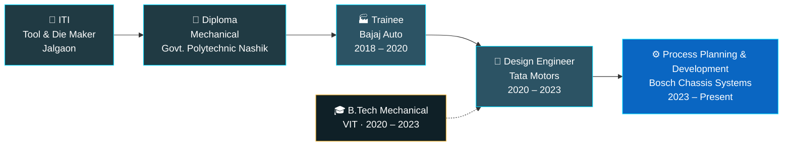

  

  

  
  
  

  
 
  
 
    

  

  
  

---

## ⚡ Quick Facts

  

  
   
  
   
  
   
  
   
  
   
  
   
  
   
  

---

## 👨‍💻 About Me

I'm a **mechanical engineer** who started on the shop floor as a **Tool & Die Maker** and has grown through **press shop operations**, **vehicle design** and now **process planning & development** at Bosch.

- 🏭 I work on **process planning**, **manufacturing technology** and **digitalization**
- 🤖 I'm interested in **industrial AI, machine vision** and **industrial automation**
- 🛠️ I have hands-on experience in **tool & die design** and **BIW tooling**
- 🚗 I've contributed to the **Bajaj Auto RE60** and **Tata Motors ALTROZ**
- 📚 Always learning, from VisionPro machine vision to Bosch Production System

---

## 🎯 Focus Areas

<table>
<tr>
<td align="center" width="33%">⚙️ <b>Process Planning & Development</b> Planning manufacturing processes at Bosch Chassis Systems</td>
<td align="center" width="33%">🏭 <b>Manufacturing Technology & Digitalization</b> Smarter, connected manufacturing</td>
<td align="center" width="33%">👁️ <b>Industrial AI & Machine Vision</b> Cognex VisionPro certified learner</td>
</tr>
<tr>
<td align="center">🔧 <b>Industrial Automation</b> Press shop automation experience</td>
<td align="center">🛠️ <b>Tool & Die Design</b> From ITI Tool & Die Maker to design</td>
<td align="center">🚘 <b>BIW Tooling & CAD</b> CATIA · Creo</td>
</tr>
</table>

---

## 🌱 Currently

| | |
|---|---|
| 🔭 **Working at** | Bosch Chassis Systems, Process Planning & Development |
| 📚 **Learning** | Machine vision (Cognex VisionPro), Bosch Production System, time data norms |
| 💬 **Ask me about** | Process planning, tool & die design, BIW tooling, CATIA / Creo, press shop operations |
| 🤝 **Looking to** | Connect with engineers in manufacturing, automation and industrial AI |

---

## 🧰 Skills

  
  
  
   
  
  
  
   
  
  
  
   
  
  
  

---

## 💼 Experience

| 📅 Period | 💼 Role | 🏢 Company | 📍 Location |
|---|---|---|---|
| Oct 2023 – Present | **Process Planning & Development MFP** | Bosch Chassis Systems | Pune District |
| Jun 2020 – Jan 2023 | **Design Engineer** | Tata Motors | Pimpri-Chinchwad, Pune |
| Sep 2018 – Jan 2020 | **Trainee** | Bajaj Auto Ltd | Aurangabad |

**At Bajaj Auto I:**
- Managed PM, breakdown, spares, logistics & automation in the 4W press shop
- Executed die offloading to vendors with zero quality complaints

---

## 🚀 Career Journey

---

## 🎓 Education

| 🎓 Qualification | 🏫 Institute |
|---|---|
| **B.Tech, Mechanical Engineering** | Vishwakarma Institute of Technology |
| **Diploma in Mechanical** | Government Polytechnic Nashik |
| **Tool & Die Maker** | Government ITI, Jalgaon |
| **Training** | NCTVT |

---

## 🏆 Certifications

- 👁️ **Vision Basics – Cognex VisionPro** · Cognex Corporation · Sep 2025
- 🏭 **BPS Basic Training-B** · Bosch India · Jun 2025 · `BPSM-SYS-321`
- ⏱️ **Industrial Engineering: Bosch Standard Time Data Norm N62C-S** · Bosch India · Nov 2025 · `BPSM-IET-312`

---

## 📫 Let's Connect

  

**💡 Learn. Build. Test. Improve.**

