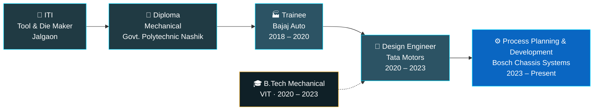

  

<h1 align="center">Hi 👋, I'm Prashant Ippar</h1>

  

  
  
  

---

## ⚡ Quick Facts

  
   
  
   
  
   
  
   
  
   
  
   
  
   
  

  

---

## 👨‍💻 About Me

I'm a **mechanical engineer** who started on the shop floor as a **Tool & Die Maker** and has grown through **press shop operations**, **vehicle design** and now **process planning & development** at Bosch.

- 🏭 I work on **process planning**, **manufacturing technology** and **digitalization**
- 🤖 I'm interested in **industrial AI, machine vision** and **industrial automation**
- 🛠️ I have hands-on experience in **tool & die design** and **BIW tooling**
- 🚗 I've contributed to the **Bajaj Auto RE60** and **Tata Motors ALTROZ**
- 📚 Always learning, from VisionPro machine vision to Bosch Production System

---

## 🎯 Focus Areas

<table>
<tr>
<td align="center" width="33%">⚙️ <b>Process Planning & Development</b> Planning manufacturing processes at Bosch Chassis Systems</td>
<td align="center" width="33%">🏭 <b>Manufacturing Technology & Digitalization</b> Smarter, connected manufacturing</td>
<td align="center" width="33%">👁️ <b>Industrial AI & Machine Vision</b> Cognex VisionPro certified learner</td>
</tr>
<tr>
<td align="center">🔧 <b>Industrial Automation</b> Press shop automation experience</td>
<td align="center">🛠️ <b>Tool & Die Design</b> From ITI Tool & Die Maker to design</td>
<td align="center">🚘 <b>BIW Tooling & CAD</b> CATIA · Creo</td>
</tr>
</table>

---

## 🌱 Currently

| | |
|---|---|
| 🔭 **Working at** | Bosch Chassis Systems, Process Planning & Development |
| 📚 **Learning** | Machine vision (Cognex VisionPro), Bosch Production System, time data norms |
| 💬 **Ask me about** | Process planning, tool & die design, BIW tooling, CATIA / Creo, press shop operations |
| 🤝 **Looking to** | Connect with engineers in manufacturing, automation and industrial AI |

---

## 🧰 Skills

  
  
  
   
  
  
  
   
  
  
  
   
  
  
  

---

## 💼 Experience

| 📅 Period | 💼 Role | 🏢 Company | 📍 Location |
|---|---|---|---|
| Oct 2023 – Present | **Process Planning & Development MFP** | Bosch Chassis Systems | Pune District |
| Jun 2020 – Jan 2023 | **Design Engineer** | Tata Motors | Pimpri-Chinchwad, Pune |
| Sep 2018 – Jan 2020 | **Trainee** | Bajaj Auto Ltd | Aurangabad |

**At Bajaj Auto I:**
- Managed PM, breakdown, spares, logistics & automation in the 4W press shop
- Executed die offloading to vendors with zero quality complaints

---

## 🚀 Career Journey

---

## 🎓 Education

| 📅 Duration | 🎓 Qualification | 🏫 Institute |
|---|---|---|
| 2020 – Mar 2023 | **B.Tech, Mechanical Engineering** | Vishwakarma Institute of Technology |
| — | **Diploma in Mechanical** | Government Polytechnic Nashik |
| — | **Tool & Die Maker** | Government ITI, Jalgaon |
| — | **Training** | NCTVT |

---

## 🏆 Certifications

- 👁️ **Vision Basics – Cognex VisionPro** · Cognex Corporation · Sep 2025
- 🏭 **BPS Basic Training-B** · Bosch India · Jun 2025 · `BPSM-SYS-321`
- ⏱️ **Industrial Engineering: Bosch Standard Time Data Norm N62C-S** · Bosch India · Nov 2025 · `BPSM-IET-312`

---

## 🐍 Contribution Snake

  

<!--
SNAKE SETUP: create file  .github/workflows/snake.yml  with:

name: Generate Snake
on:
  schedule:
    - cron: "0 0 * * *"
  workflow_dispatch:
jobs:
  generate:
    runs-on: ubuntu-latest
    permissions:
      contents: write
    steps:
      - uses: Platane/snk/svg-only@v3
        with:
          github_user_name: ${{ github.repository_owner }}
          outputs: dist/github-snake.svg
      - uses: crazy-max/ghaction-github-pages@v3.1.0
        with:
          target_branch: output
          build_dir: dist
        env:
          GITHUB_TOKEN: ${{ secrets.GITHUB_TOKEN }}

Then Actions tab > "Generate Snake" > Run workflow.
-->

---

<h3 align="center">⚙️ Precision in process. Curiosity in technology. ⚙️</h3>

---

## 📫 Connect With Me

  
  

  

