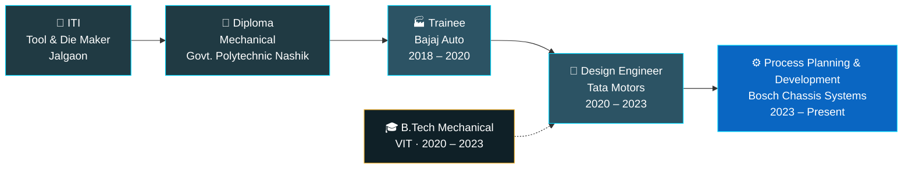

  
<svg xmlns="http://www.w3.org/2000/svg" viewBox="0 0 1280 300" width="1280" height="300" role="img" aria-label="Prashant Ippar - Process Planning, Manufacturing Technology, Industrial AI" xmlns:c2pa="http://c2pa.org/manifest">
  <defs>
    <linearGradient id="bg" x1="0" y1="0" x2="1" y2="1">
      <stop offset="0" stop-color="#0f2027"/>
      <stop offset="0.5" stop-color="#203a43"/>
      <stop offset="1" stop-color="#2c5364"/>
    </linearGradient>
    <linearGradient id="name" x1="0" y1="0" x2="1" y2="0">
      <stop offset="0" stop-color="#ffffff"/>
      <stop offset="1" stop-color="#9fe9ff"/>
    </linearGradient>
    <linearGradient id="accent" x1="0" y1="0" x2="1" y2="0">
      <stop offset="0" stop-color="#00d9ff"/>
      <stop offset="1" stop-color="#0A66C2"/>
    </linearGradient>
    <linearGradient id="scan" x1="0" y1="0" x2="1" y2="0">
      <stop offset="0" stop-color="#00d9ff" stop-opacity="0"/>
      <stop offset="0.5" stop-color="#00d9ff" stop-opacity="0.9"/>
      <stop offset="1" stop-color="#00d9ff" stop-opacity="0"/>
    </linearGradient>
    <pattern id="grid" width="30" height="30" patternUnits="userSpaceOnUse">
      <path d="M30 0H0V30" fill="none" stroke="#00d9ff" stroke-opacity="0.07" stroke-width="1"/>
    </pattern>
    <filter id="glow" x="-20%" y="-20%" width="140%" height="140%">
      <feGaussianBlur stdDeviation="2.5" result="b"/>
      <feMerge><feMergeNode in="b"/><feMergeNode in="SourceGraphic"/></feMerge>
    </filter>
    <g id="gear">
      <circle r="60" fill="none" stroke="#00d9ff" stroke-width="16" stroke-dasharray="11.78 11.78" stroke-opacity="0.85"/>
      <circle r="56" fill="#0f2027" stroke="#00d9ff" stroke-width="2"/>
      <circle r="36" fill="none" stroke="#00d9ff" stroke-opacity="0.5" stroke-width="2"/>
      <g stroke="#00d9ff" stroke-opacity="0.5" stroke-width="3">
        <line x1="-36" y1="0" x2="36" y2="0"/>
        <line x1="0" y1="-36" x2="0" y2="36"/>
        <line x1="-25" y1="-25" x2="25" y2="25"/>
        <line x1="-25" y1="25" x2="25" y2="-25"/>
      </g>
      <circle r="10" fill="#F7B731"/>
    </g>
  </defs>

  <!-- Background -->
  <rect width="1280" height="300" fill="url(#bg)"/>
  <rect width="1280" height="300" fill="url(#grid)"/>
  <circle cx="1000" cy="150" r="260" fill="#00d9ff" opacity="0.04"/>

  <!-- Left: text -->
  <g font-family="'Segoe UI', Roboto, Arial, sans-serif">
    <rect x="60" y="52" width="268" height="26" rx="13" fill="#0A66C2" fill-opacity="0.35" stroke="#00d9ff" stroke-opacity="0.6"/>
    <text x="76" y="70" font-size="12.5" font-weight="600" letter-spacing="1.5" fill="#9fe9ff">BOSCH CHASSIS SYSTEMS · PUNE</text>

    <text x="58" y="148" font-size="68" font-weight="800" fill="url(#name)" filter="url(#glow)">Prashant Ippar</text>

    <text x="60" y="190" font-family="'Fira Code', 'Courier New', monospace" font-size="18" font-weight="600" fill="#2C9FD9">Process Planning  |  Manufacturing Technology  |  Industrial AI</text>

    <text x="60" y="224" font-size="15" fill="#cfe3ea" fill-opacity="0.85">Tool &amp; Die Maker  →  Press Shop  →  Vehicle Design  →  Process Planning</text>

    <text x="60" y="256" font-size="13" fill="#F7B731" letter-spacing="2">FROM SHOP FLOOR TO SMART FACTORY</text>
  </g>

  <!-- Right: car body (BIW) with machine vision frame -->
  <g transform="translate(785,95)">
    <!-- car outline -->
    <g fill="none" stroke="#00d9ff" stroke-width="2.5" stroke-linejoin="round" stroke-linecap="round" filter="url(#glow)">
      <path d="M0,88 L0,66 Q4,52 40,47 L82,22 Q112,6 156,6 L204,6 Q238,10 258,44 L286,50 Q300,56 300,88 Z"/>
      <path d="M96,26 L90,47 L250,47 L226,22 Z" stroke-opacity="0.7"/>
      <line x1="168" y1="8" x2="168" y2="88" stroke-opacity="0.5"/>
    </g>
    <!-- wheels -->
    <g>
      <circle cx="68" cy="90" r="22" fill="#0f2027" stroke="#00d9ff" stroke-width="2.5"/>
      <circle cx="68" cy="90" r="8" fill="none" stroke="#F7B731" stroke-width="2"/>
      <circle cx="238" cy="90" r="22" fill="#0f2027" stroke="#00d9ff" stroke-width="2.5"/>
      <circle cx="238" cy="90" r="8" fill="none" stroke="#F7B731" stroke-width="2"/>
    </g>
    <!-- spot weld points -->
    <g fill="#F7B731">
      <circle cx="40" cy="47" r="3"><animate attributeName="opacity" values="1;0.2;1" dur="2s" repeatCount="indefinite"/></circle>
      <circle cx="90" cy="47" r="3"><animate attributeName="opacity" values="1;0.2;1" dur="2s" begin="0.4s" repeatCount="indefinite"/></circle>
      <circle cx="168" cy="47" r="3"><animate attributeName="opacity" values="1;0.2;1" dur="2s" begin="0.8s" repeatCount="indefinite"/></circle>
      <circle cx="250" cy="47" r="3"><animate attributeName="opacity" values="1;0.2;1" dur="2s" begin="1.2s" repeatCount="indefinite"/></circle>
    </g>

    <!-- vision scan line -->
    <rect x="-8" y="-6" width="40" height="124" fill="url(#scan)">
      <animateTransform attributeName="transform" type="translate" values="0 0; 276 0; 0 0" dur="4.5s" repeatCount="indefinite"/>
    </rect>

    <!-- vision corner brackets -->
    <g fill="none" stroke="#F7B731" stroke-width="3" stroke-linecap="round">
      <path d="M-16,-14 H-16 V14 M-16,-14 H12"/>
      <path d="M316,-14 H288 M316,-14 V14"/>
      <path d="M-16,124 H12 M-16,124 V96"/>
      <path d="M316,124 H288 M316,124 V96"/>
    </g>
    <text x="-16" y="146" font-family="'Fira Code','Courier New',monospace" font-size="11" fill="#F7B731" fill-opacity="0.9" letter-spacing="1">VISION · INSPECT · OK
      <animate attributeName="opacity" values="1;0.4;1" dur="2.2s" repeatCount="indefinite"/>
    </text>
  </g>

  <!-- Gears (manufacturing) -->
  <g transform="translate(1170,92) scale(0.75)">
    <use href="#gear">
      <animateTransform attributeName="transform" type="rotate" from="0" to="360" dur="24s" repeatCount="indefinite"/>
    </use>
  </g>
  <g transform="translate(1226,146) scale(0.5)">
    <use href="#gear">
      <animateTransform attributeName="transform" type="rotate" from="360" to="0" dur="15s" repeatCount="indefinite"/>
    </use>
  </g>

  <!-- AI node network -->
  <g stroke="#00d9ff" stroke-opacity="0.35" stroke-width="1.2">
    <line x1="1130" y1="215" x2="1180" y2="240"/>
    <line x1="1180" y1="240" x2="1235" y2="215"/>
    <line x1="1180" y1="240" x2="1215" y2="272"/>
    <line x1="1235" y1="215" x2="1215" y2="272"/>
  </g>
  <g fill="#00d9ff">
    <circle cx="1130" cy="215" r="4"/>
    <circle cx="1180" cy="240" r="5"/>
    <circle cx="1235" cy="215" r="4"/>
    <circle cx="1215" cy="272" r="4"/>
    <circle cx="1180" cy="240" r="9" fill="none" stroke="#00d9ff" stroke-opacity="0.6">
      <animate attributeName="r" values="5;14;5" dur="2.6s" repeatCount="indefinite"/>
      <animate attributeName="opacity" values="0.8;0;0.8" dur="2.6s" repeatCount="indefinite"/>
    </circle>
  </g>

  <!-- Bottom accent bar -->
  <rect y="294" width="1280" height="6" fill="url(#accent)"/>
<metadata><c2pa:manifest>AAAWgmp1bWIAAAAeanVtZGMycGEAEQAQgAAAqgA4m3EDYzJwYQAAABZcanVtYgAAAEdqdW1kYzJtYQARABCAAACqADibcQN1cm46YzJwYTo1ZDRiMDc3ZS02MWZhLTRlZjEtOThkOC0yNDFiYTAzZmUzNTIAAAADl2p1bWIAAAApanVtZGMyYXMAEQAQgAAAqgA4m3EDYzJwYS5hc3NlcnRpb25zAAAAALxqdW1iAAAARGp1bWRjYm9yABEAEIAAAKoAOJtxE2MycGEuaW5ncmVkaWVudC52MwAAAAAYYzJzaBEFSJ+LXkUsEGAazPThXBAAAABwY2JvcqNpZGM6Zm9ybWF0bWltYWdlL3N2Zyt4bWxqaW5zdGFuY2VJRHgseG1wOmlpZDpjOTgzMDllOC02MDYzLTQ3NzgtYWNhZi1hM2FlYWU1NDdjZWZscmVsYXRpb25zaGlwaHBhcmVudE9mAAAB4mp1bWIAAABBanVtZGNib3IAEQAQgAAAqgA4m3ETYzJwYS5hY3Rpb25zLnYyAAAAABhjMnNoFHaU07k4C3axmRdu/oC+OgAAAZljYm9yomdhY3Rpb25zgqJmYWN0aW9ua2MycGEub3BlbmVkanBhcmFtZXRlcnOha2luZ3JlZGllbnRzgaJjdXJseC1zZWxmI2p1bWJmPWMycGEuYXNzZXJ0aW9ucy9jMnBhLmluZ3JlZGllbnQudjNkaGFzaFgg813kf4JVhvF5NBrhEkn/6N1uPhcDVrGsTUX2Hc+9e4ykZmFjdGlvbngdY29tLmFudGhyb3BpYy5jbGF1ZGUucHJvdmlkZWRqcGFyYW1ldGVyc6F4H2NvbS5hbnRocm9waWMub3JpZ2luLWNvbmZpZGVuY2VndW5rbm93bmtkZXNjcmlwdGlvbnhmQ2xhdWRlIHByb3ZpZGVkIHRoaXMgZmlsZSBhdCB0aGUgcmVxdWVzdCBvZiBhIHVzZXIgYW5kIG1heSBoYXZlIGNyZWF0ZWQgb3IgbW9kaWZpZWQgdGhlIGZpbGUgY29udGVudHMubXNvZnR3YXJlQWdlbnShZG5hbWVmQ2xhdWRlcmFsbEFjdGlvbnNJbmNsdWRlZPUAAADIanVtYgAAAEBqdW1kY2JvcgARABCAAACqADibcRNjMnBhLmhhc2guZGF0YQAAAAAYYzJzaGc3v3/X5qm55pnKiP0xIJwAAACAY2JvcqVjYWxnZnNoYTI1NmNwYWRMAAAAAAAAAAAAAAAAZGhhc2hYIGABhutws2n3ZdYcivzpgCnH1dB0rxc4y2xY/hNue1KTZG5hbWVuanVtYmYgbWFuaWZlc3RqZXhjbHVzaW9uc4GiZXN0YXJ0GRsYZmxlbmd0aBkeBAAAAj5qdW1iAAAAJ2p1bWRjMmNsABEAEIAAAKoAOJtxA2MycGEuY2xhaW0udjIAAAACD2Nib3KlY2FsZ2ZzaGEyNTZpc2lnbmF0dXJleE1zZWxmI2p1bWJmPS9jMnBhL3VybjpjMnBhOjVkNGIwNzdlLTYxZmEtNGVmMS05OGQ4LTI0MWJhMDNmZTM1Mi9jMnBhLnNpZ25hdHVyZWppbnN0YW5jZUlEeCx4bXA6aWlkOmNjMDVkZmQ4LWQ5ODUtNDBjMS05MmQ0LTUwMDgyY2U2ZWUxNnJjcmVhdGVkX2Fzc2VydGlvbnODomN1cmx4LXNlbGYjanVtYmY9YzJwYS5hc3NlcnRpb25zL2MycGEuaW5ncmVkaWVudC52M2RoYXNoWCDzXeR/glWG8Xk0GuESSf/o3W4+FwNWsaxNRfYdz717jKJjdXJseCpzZWxmI2p1bWJmPWMycGEuYXNzZXJ0aW9ucy9jMnBhLmFjdGlvbnMudjJkaGFzaFggzZvaqh9eKhS2a6BWwmCa3HFMBA+KCXTD1iUv7T4AvtiiY3VybHgpc2VsZiNqdW1iZj1jMnBhLmFzc2VydGlvbnMvYzJwYS5oYXNoLmRhdGFkaGFzaFggrPKXt2UEEDZqMMweKIPWJqOkd2ZqSX5qtJqmfARbTQF0Y2xhaW1fZ2VuZXJhdG9yX2luZm+jZG5hbWVvQW50aHJvcGljIEZpbGVzZ3ZlcnNpb25lMS4wLjBrc3BlY1ZlcnNpb25lMi40LjAAABA4anVtYgAAAChqdW1kYzJjcwARABCAAACqADibcQNjMnBhLnNpZ25hdHVyZQAAABAIY2JvctKEWQISogEmGCFZAgowggIGMIIBjaADAgECAhRA5aAK7sI50L64g/oGQgU9Z1UTADAKBggqhkjOPQQDAzBJMRcwFQYDVQQKEw5BbnRocm9waWMsIFBCQzEuMCwGA1UEAxMlQW50aHJvcGljIENvbnRlbnQgQ3JlZGVudGlhbHMgUm9vdCBDQTAeFw0yNjA4MDcxODQzNTZaFw0yODA4MDYxOTQzNTZaMEQxFzAVBgNVBAoTDkFudGhyb3BpYywgUEJDMSkwJwYDVQQDEyBBbnRocm9waWMgQ2xhdWRlIENvbnRlbnQgU2lnbmluZzBZMBMGByqGSM49AgEGCCqGSM49AwEHA0IABJh6CmvLUBgFFNU0vUKlOVtE6djd17L5SuwX0LemFisBM3dkd/3cyjxFA3Qo5S46fX0/ihY0VZ7mfb9KF703t5OjWDBWMA4GA1UdDwEB/wQEAwIHgDAVBgNVHSUEDjAMBgorBgEEAYPoXgIBMAwGA1UdEwEB/wQCMAAwHwYDVR0jBBgwFoAUzlHiBIFOZFsj+OPEz5o+nMHXXMIwCgYIKoZIzj0EAwMDZwAwZAIwMXMdFJ4BetLLVY7ORuE9noqbbAZOZn/aArXyTwFAZfKrPzxF2vPoJNf1+UCdg1XGAjBwX1zd9WGqYkqmL5SFqw1QySjr1zJfpJM9+1rdDwSPLMOPOjKuiXjoU/pUUeG9RwmhY3BhZFkNngAAAAAAAAAAAAAAAAAAAAAAAAAAAAAAAAAAAAAAAAAAAAAAAAAAAAAAAAAAAAAAAAAAAAAAAAAAAAAAAAAAAAAAAAAAAAAAAAAAAAAAAAAAAAAAAAAAAAAAAAAAAAAAAAAAAAAAAAAAAAAAAAAAAAAAAAAAAAAAAAAAAAAAAAAAAAAAAAAAAAAAAAAAAAAAAAAAAAAAAAAAAAAAAAAAAAAAAAAAAAAAAAAAAAAAAAAAAAAAAAAAAAAAAAAAAAAAAAAAAAAAAAAAAAAAAAAAAAAAAAAAAAAAAAAAAAAAAAAAAAAAAAAAAAAAAAAAAAAAAAAAAAAAAAAAAAAAAAAAAAAAAAAAAAAAAAAAAAAAAAAAAAAAAAAAAAAAAAAAAAAAAAAAAAAAAAAAAAAAAAAAAAAAAAAAAAAAAAAAAAAAAAAAAAAAAAAAAAAAAAAAAAAAAAAAAAAAAAAAAAAAAAAAAAAAAAAAAAAAAAAAAAAAAAAAAAAAAAAAAAAAAAAAAAAAAAAAAAAAAAAAAAAAAAAAAAAAAAAAAAAAAAAAAAAAAAAAAAAAAAAAAAAAAAAAAAAAAAAAAAAAAAAAAAAAAAAAAAAAAAAAAAAAAAAAAAAAAAAAAAAAAAAAAAAAAAAAAAAAAAAAAAAAAAAAAAAAAAAAAAAAAAAAAAAAAAAAAAAAAAAAAAAAAAAAAAAAAAAAAAAAAAAAAAAAAAAAAAAAAAAAAAAAAAAAAAAAAAAAAAAAAAAAAAAAAAAAAAAAAAAAAAAAAAAAAAAAAAAAAAAAAAAAAAAAAAAAAAAAAAAAAAAAAAAAAAAAAAAAAAAAAAAAAAAAAAAAAAAAAAAAAAAAAAAAAAAAAAAAAAAAAAAAAAAAAAAAAAAAAAAAAAAAAAAAAAAAAAAAAAAAAAAAAAAAAAAAAAAAAAAAAAAAAAAAAAAAAAAAAAAAAAAAAAAAAAAAAAAAAAAAAAAAAAAAAAAAAAAAAAAAAAAAAAAAAAAAAAAAAAAAAAAAAAAAAAAAAAAAAAAAAAAAAAAAAAAAAAAAAAAAAAAAAAAAAAAAAAAAAAAAAAAAAAAAAAAAAAAAAAAAAAAAAAAAAAAAAAAAAAAAAAAAAAAAAAAAAAAAAAAAAAAAAAAAAAAAAAAAAAAAAAAAAAAAAAAAAAAAAAAAAAAAAAAAAAAAAAAAAAAAAAAAAAAAAAAAAAAAAAAAAAAAAAAAAAAAAAAAAAAAAAAAAAAAAAAAAAAAAAAAAAAAAAAAAAAAAAAAAAAAAAAAAAAAAAAAAAAAAAAAAAAAAAAAAAAAAAAAAAAAAAAAAAAAAAAAAAAAAAAAAAAAAAAAAAAAAAAAAAAAAAAAAAAAAAAAAAAAAAAAAAAAAAAAAAAAAAAAAAAAAAAAAAAAAAAAAAAAAAAAAAAAAAAAAAAAAAAAAAAAAAAAAAAAAAAAAAAAAAAAAAAAAAAAAAAAAAAAAAAAAAAAAAAAAAAAAAAAAAAAAAAAAAAAAAAAAAAAAAAAAAAAAAAAAAAAAAAAAAAAAAAAAAAAAAAAAAAAAAAAAAAAAAAAAAAAAAAAAAAAAAAAAAAAAAAAAAAAAAAAAAAAAAAAAAAAAAAAAAAAAAAAAAAAAAAAAAAAAAAAAAAAAAAAAAAAAAAAAAAAAAAAAAAAAAAAAAAAAAAAAAAAAAAAAAAAAAAAAAAAAAAAAAAAAAAAAAAAAAAAAAAAAAAAAAAAAAAAAAAAAAAAAAAAAAAAAAAAAAAAAAAAAAAAAAAAAAAAAAAAAAAAAAAAAAAAAAAAAAAAAAAAAAAAAAAAAAAAAAAAAAAAAAAAAAAAAAAAAAAAAAAAAAAAAAAAAAAAAAAAAAAAAAAAAAAAAAAAAAAAAAAAAAAAAAAAAAAAAAAAAAAAAAAAAAAAAAAAAAAAAAAAAAAAAAAAAAAAAAAAAAAAAAAAAAAAAAAAAAAAAAAAAAAAAAAAAAAAAAAAAAAAAAAAAAAAAAAAAAAAAAAAAAAAAAAAAAAAAAAAAAAAAAAAAAAAAAAAAAAAAAAAAAAAAAAAAAAAAAAAAAAAAAAAAAAAAAAAAAAAAAAAAAAAAAAAAAAAAAAAAAAAAAAAAAAAAAAAAAAAAAAAAAAAAAAAAAAAAAAAAAAAAAAAAAAAAAAAAAAAAAAAAAAAAAAAAAAAAAAAAAAAAAAAAAAAAAAAAAAAAAAAAAAAAAAAAAAAAAAAAAAAAAAAAAAAAAAAAAAAAAAAAAAAAAAAAAAAAAAAAAAAAAAAAAAAAAAAAAAAAAAAAAAAAAAAAAAAAAAAAAAAAAAAAAAAAAAAAAAAAAAAAAAAAAAAAAAAAAAAAAAAAAAAAAAAAAAAAAAAAAAAAAAAAAAAAAAAAAAAAAAAAAAAAAAAAAAAAAAAAAAAAAAAAAAAAAAAAAAAAAAAAAAAAAAAAAAAAAAAAAAAAAAAAAAAAAAAAAAAAAAAAAAAAAAAAAAAAAAAAAAAAAAAAAAAAAAAAAAAAAAAAAAAAAAAAAAAAAAAAAAAAAAAAAAAAAAAAAAAAAAAAAAAAAAAAAAAAAAAAAAAAAAAAAAAAAAAAAAAAAAAAAAAAAAAAAAAAAAAAAAAAAAAAAAAAAAAAAAAAAAAAAAAAAAAAAAAAAAAAAAAAAAAAAAAAAAAAAAAAAAAAAAAAAAAAAAAAAAAAAAAAAAAAAAAAAAAAAAAAAAAAAAAAAAAAAAAAAAAAAAAAAAAAAAAAAAAAAAAAAAAAAAAAAAAAAAAAAAAAAAAAAAAAAAAAAAAAAAAAAAAAAAAAAAAAAAAAAAAAAAAAAAAAAAAAAAAAAAAAAAAAAAAAAAAAAAAAAAAAAAAAAAAAAAAAAAAAAAAAAAAAAAAAAAAAAAAAAAAAAAAAAAAAAAAAAAAAAAAAAAAAAAAAAAAAAAAAAAAAAAAAAAAAAAAAAAAAAAAAAAAAAAAAAAAAAAAAAAAAAAAAAAAAAAAAAAAAAAAAAAAAAAAAAAAAAAAAAAAAAAAAAAAAAAAAAAAAAAAAAAAAAAAAAAAAAAAAAAAAAAAAAAAAAAAAAAAAAAAAAAAAAAAAAAAAAAAAAAAAAAAAAAAAAAAAAAAAAAAAAAAAAAAAAAAAAAAAAAAAAAAAAAAAAAAAAAAAAAAAAAAAAAAAAAAAAAAAAAAAAAAAAAAAAAAAAAAAAAAAAAAAAAAAAAAAAAAAAAAAAAAAAAAAAAAAAAAAAAAAAAAAAAAAAAAAAAAAAAAAAAAAAAAAAAAAAAAAAAAAAAAAAAAAAAAAAAAAAAAAAAAAAAAAAAAAAAAAAAAAAAAAAAAAAAAAAAAAAAAAAAAAAAAAAAAAAAAAAAAAAAAAAAAAAAAAAAAAAAAAAAAAAAAAAAAAAAAAAAAAAAAAAAAAAAAAAAAAAAAAAAAAAAAAAAAAAAAAAAAAAAAAAAAAAAAAAAAAAAAAAAAAAAAAAAAAAAAAAAAAAAAAAAAAAAAAAAAAAAAAAAAAAAAAAAAAAAAAAAAAAAAAAAAAAAAAAAAAAAAAAAAAAAAAAAAAAAAAAAAAAAAAAAAAAAAAAAAAAAAAAAAAAAAAAAAAAAAAAAAAAAAAAAAAAAAAAAAAAAAAAAAAAAAAAAAAAAAAAAAAAAAAAAAAAAAAAAAAAAAAAAAAAAAAAAAAAAAAAAAAAAAAAAAAAAAAAAAAAAAAAAAAAAAAAAAAAAAAAAAAAAAAAAAAAAAAAAAAAAAAAAAAAAAAAAAAAAAAAAAAAAAAAAAAAAAAAAAAAAAAAAAAAAAAAAAAAAAAAAAAAAAAAAAAAAAAAAAAAAAAAAAAAAAAAAAAAAAAAAAAAAAAAAAAAAAAAAAAAAAAAAAAAAAAAAAAAAAAAAAAAAAAAAAAAAAAAAAAAAAAAAAAAAAAAAAAAAAAAAAAAAAAAAAAAAAAAAAAAAAAAAAAAAAAAAAAAAAAAAAAAAAAAAAAAAAAAAAAAAAAAAAAAAAAAAAAAAAAAAAAAAAAAAAAAAAAAAAAAAAAAAAAAAAAAAAAAAAAAAAAAAAAAAAAAAAAAAAAAAAAAAAAAAAAAAAAAAAAAAAAAAAAAAAAAAAAAAAAAAAAAAAAAAAAAAAAAAAAAAAAAAAAAAAAAAAAAAAAAAAAAAAAAAAAAAAAAAAAAAAAAAAAAAAAAAAAAAAAAAAAAAAAAAAAAAAAAAAAAAAAAAAAAAAAAAAAAAAAAAAAAAAAAAAAAAAAAAAAAAAAAAAAAAAAAAAAAAAAAAAAAAAAAAAAAAAAAAAAAAAAAAAAAAAAAAAAAAAAAAAAAAAAAAAAAAAAAAAAAAAAAAAAAAAAAAAAAAAAAAAAAAAAAAAAAAAAAAAAAAAAAAAAAAAAAAAAAAAAAAAAAAAAAAAAAAAAAAAAAAAAAAAAAAAAAAAAAAAAAAAAAAAAAAAAAAAAAAAAAAAAAAAAAAAAAAAAAAAAAAAAAAAAAAAAAAAAAAAAAAAAAAAAAAAAAAAAAAAAAAAAAAAAAAAAAAAAAAAAAAAAAAAAAAAAAAAAAAAAAAAAAAAAAAAAAAAAAAAAAAAAAAAAAAAAAAAAAAAAAAAAAAAAAAAAAAAAAAAAAAAAAAAAAAAAAAAAAAAAAAAAAAAAAAAAAAAAAAAAAAAAAAAAAAAAAAAAAAAAAAAAAAAAAAAAAAAAAAAAAAAAAAAAPZYQBEjZDSvOc+sQC4qE9ezhj5uPnKNrHJm3P1T6GZN5eKQZd75Q//9J6wXWYN+eYlpNwnXNiPritPfQnJMIyJwzLs=</c2pa:manifest></metadata></svg>

  

  
  
  

  
 
  
 
    

  

  
  

---

## ⚡ Quick Facts

  

  
   
  
   
  
   
  
   
  
   
  
   
  
   
  

---

## 👨‍💻 About Me

I'm a **mechanical engineer** who started on the shop floor as a **Tool & Die Maker** and has grown through **press shop operations**, **vehicle design** and now **process planning & development** at Bosch.

- 🏭 I work on **process planning**, **manufacturing technology** and **digitalization**
- 🤖 I'm interested in **industrial AI, machine vision** and **industrial automation**
- 🛠️ I have hands-on experience in **tool & die design** and **BIW tooling**
- 🚗 I've contributed to the **Bajaj Auto RE60** and **Tata Motors ALTROZ**
- 📚 Always learning, from VisionPro machine vision to Bosch Production System

---

## 🎯 Focus Areas

<table>
<tr>
<td align="center" width="33%">⚙️ <b>Process Planning & Development</b> Planning manufacturing processes at Bosch Chassis Systems</td>
<td align="center" width="33%">🏭 <b>Manufacturing Technology & Digitalization</b> Smarter, connected manufacturing</td>
<td align="center" width="33%">👁️ <b>Industrial AI & Machine Vision</b> Cognex VisionPro certified learner</td>
</tr>
<tr>
<td align="center">🔧 <b>Industrial Automation</b> Press shop automation experience</td>
<td align="center">🛠️ <b>Tool & Die Design</b> From ITI Tool & Die Maker to design</td>
<td align="center">🚘 <b>BIW Tooling & CAD</b> CATIA · Creo</td>
</tr>
</table>

---

## 🌱 Currently

| | |
|---|---|
| 🔭 **Working at** | Bosch Chassis Systems, Process Planning & Development |
| 📚 **Learning** | Machine vision (Cognex VisionPro), Bosch Production System, time data norms |
| 💬 **Ask me about** | Process planning, tool & die design, BIW tooling, CATIA / Creo, press shop operations |
| 🤝 **Looking to** | Connect with engineers in manufacturing, automation and industrial AI |

---

## 🧰 Skills

  
  
  
   
  
  
  
   
  
  
  
   
  
  
  

---

## 💼 Experience

| 📅 Period | 💼 Role | 🏢 Company | 📍 Location |
|---|---|---|---|
| Oct 2023 – Present | **Process Planning & Development MFP** | Bosch Chassis Systems | Pune District |
| Jun 2020 – Jan 2023 | **Design Engineer** | Tata Motors | Pimpri-Chinchwad, Pune |
| Sep 2018 – Jan 2020 | **Trainee** | Bajaj Auto Ltd | Aurangabad |

**At Bajaj Auto I:**
- Managed PM, breakdown, spares, logistics & automation in the 4W press shop
- Executed die offloading to vendors with zero quality complaints

---

## 🚀 Career Journey

---

## 🎓 Education

| 🎓 Qualification | 🏫 Institute |
|---|---|
| **B.Tech, Mechanical Engineering** | Vishwakarma Institute of Technology |
| **Diploma in Mechanical** | Government Polytechnic Nashik |
| **Tool & Die Maker** | Government ITI, Jalgaon |
| **Training** | NCTVT |

---

## 🏆 Certifications

- 👁️ **Vision Basics – Cognex VisionPro** · Cognex Corporation · Sep 2025
- 🏭 **BPS Basic Training-B** · Bosch India · Jun 2025 · `BPSM-SYS-321`
- ⏱️ **Industrial Engineering: Bosch Standard Time Data Norm N62C-S** · Bosch India · Nov 2025 · `BPSM-IET-312`

---

## 📫 Let's Connect

  

**🏭 From shop floor to smart factory, one process at a time.**

**⚙️ Tool & Die to Industrial AI. Always building.**

**🔧 Precision on the shop floor. Intelligence in the process.**

