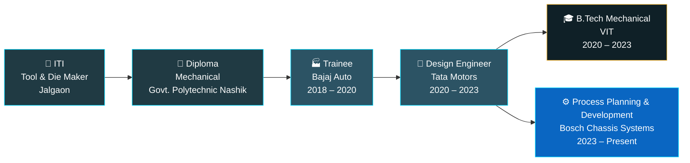

<!-- ===== Animated banner (custom SVG in /assets) ===== -->

  

<!-- ===== Typing animation ===== -->

  

  
  
  

## 👨‍💻 About Me

<table>
<tr>
<td width="62%">

👋 Hello! I'm **Prashant Ippar** (He/Him)

⚙️ **Process Planning & Development** | **Manufacturing Technology & Digitalization**

🤖 **Industrial AI & Machine Vision** | **Industrial Automation**

🛠️ **Tool & Die Design** | **BIW Tooling** | **CATIA** | **Creo**

🚗 Worked on **Bajaj Auto – RE60** and **Tata Motors – ALTROZ**

🏭 Currently at **Bosch Chassis Systems**

📍 Pune / Pimpri-Chinchwad, Maharashtra, India

</td>
<td width="38%" align="center">

</td>
</tr>
</table>

## 🛠️ Skills & Expertise

  
  
  
   
  
  
  
   
  
  
   
  
  
  
  

## 🚀 Career Journey

## 💼 Experience

<table>
<tr>
<td width="140" align="center"> Oct 2023 – Present</td>
<td>

**Process Planning & Development MFP**
Bosch Chassis Systems · Full-time
📍 Pune District, Maharashtra · On-site

</td>
</tr>
<tr>
<td width="140" align="center"> Jun 2020 – Jan 2023</td>
<td>

**Design Engineer**
Tata Motors · Full-time
📍 Pimpri-Chinchwad, Pune, Maharashtra
🧰 Computer-Aided Design (CAD)

</td>
</tr>
<tr>
<td width="140" align="center"> Sep 2018 – Jan 2020</td>
<td>

**Trainee**
Bajaj Auto Ltd · Full-time
📍 Aurangabad, Maharashtra · On-site
- Managed PM, breakdown, spares, logistics & automation in the 4W press shop
- Executed die offloading to vendors with zero quality complaints

</td>
</tr>
</table>

## 🎓 Education

| 🏫 Institute | 📘 Qualification | 📅 Duration |
|---|---|---|
| **Vishwakarma Institute of Technology** | Bachelor of Technology, Mechanical Engineering | 2020 – Mar 2023 |
| **Government Polytechnic Nashik** | Diploma in Mechanical | — |
| **Government ITI, Jalgaon** | Tool and Die Maker (Engineering) | — |
| **NCTVT** — National Council of Training in Vocational Trades | Training | — |

## 🏆 Licenses & Certifications

| Certification | Issued by | Date | Credential ID |
|---|---|---|---|
| 👁️ **Vision Basics – Cognex VisionPro** | Cognex Corporation | Sep 2025 | — |
| 🏭 **BPS Basic Training-B** | Bosch India | Jun 2025 | `BPSM-SYS-321` |
| ⏱️ **Industrial Engineering: Bosch Standard Time Data Norm N62C-S** | Bosch India | Nov 2025 | `BPSM-IET-312` |

## 📊 GitHub Stats

  
  

  

  

  

## 🐍 Contribution Snake

  

<!--
SNAKE SETUP: create file  .github/workflows/snake.yml  with:

name: Generate Snake
on:
  schedule:
    - cron: "0 0 * * *"
  workflow_dispatch:
jobs:
  generate:
    runs-on: ubuntu-latest
    permissions:
      contents: write
    steps:
      - uses: Platane/snk/svg-only@v3
        with:
          github_user_name: ${{ github.repository_owner }}
          outputs: dist/github-snake.svg
      - uses: crazy-max/ghaction-github-pages@v3.1.0
        with:
          target_branch: output
          build_dir: dist
        env:
          GITHUB_TOKEN: ${{ secrets.GITHUB_TOKEN }}

Then Actions tab > "Generate Snake" > Run workflow.
-->

  

## 📫 Let's Connect

  
  

  

